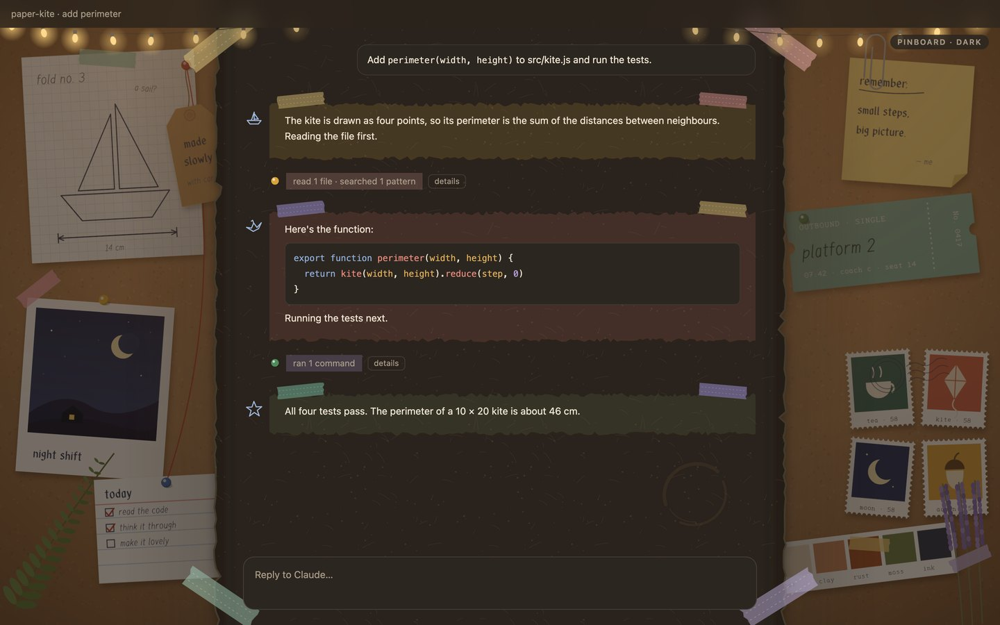
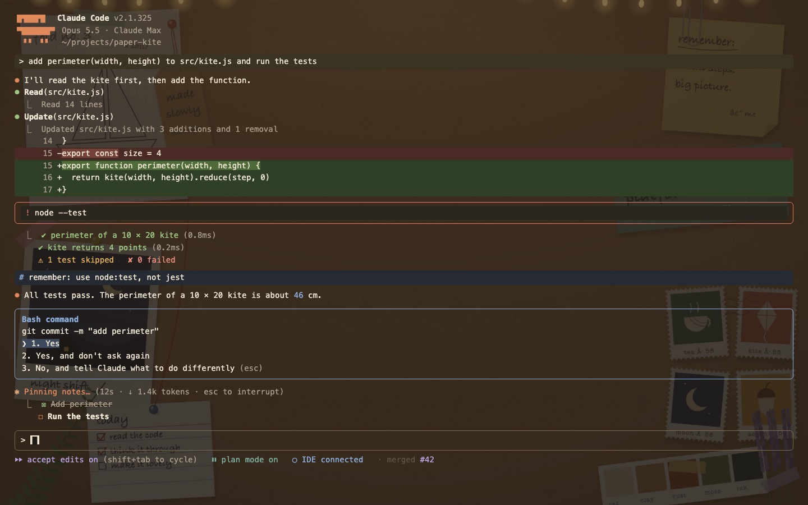
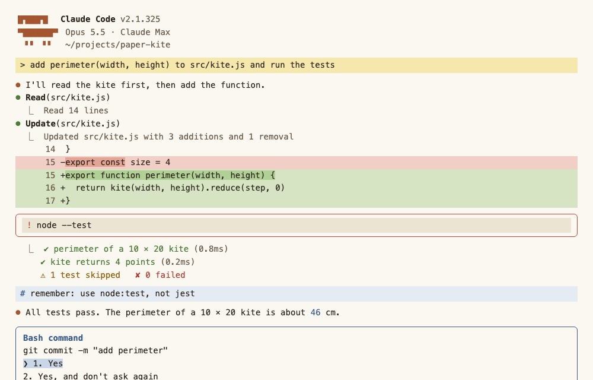

# Pinboard

A hand-made look for Claude. The conversation is written on a torn strip of cream paper taped to a cork board, and the edges of the board hold pinned scraps: a paper-boat plan on graph paper, a polaroid of a cabin under the moon, a hanging kraft tag, an index card, a sticky note, a train ticket, postage stamps, paint swatches, a fern and some lavender.

- **A scrapbook of replies**: each block of Claude's reply sits on its own torn scrap (kraft, manila, rose or sage) held by two strips of washi tape, with a small ink doodle beside it: a paper boat, a crane, a kite, a star or a leaf. Each run of tool calls is a strip of tape under a colored pin. A message's paper, tape and doodle are the same every time it is drawn.
- **Its own lettering**: the notes on the board are written in three pens drawn for Pinboard: a leaning ballpoint, a chisel marker and a typewriter with an inked ribbon. They're drawn as outlines, so they look the same everywhere with nothing to install.
- **The strip**: taped to the cork at all four corners, with a faint speckle and a mug ring near the foot. Words stay real text, so they can be selected and links work.
- **Light mode**: warm cork and cream paper, ink-blue accents.
- **Dark mode**: the same board under a desk lamp, with string lights that softly twinkle.
- **While Claude works**: the string lights come on and run along the wire, and the tag sways a little faster. They settle when the turn ends.

| Light | Dark |
| --- | --- |
|  |  |

The board and the paper scraps draw in the desktop app; the phone app draws the board and the strip.

The app draws the board across the whole window, so the strip sits in the middle of the window. It lines up with the words when the sidebar and side panes are closed. With one open, the words move over and a thin frosted column keeps them readable.

## In the terminal

A terminal can't draw the board, so Pinboard brings it two ways.

**Claude Code theme.** Two color themes from the same board: rust and clay for Claude, ink blue for prompts and links, pin red around shell commands, and your messages on sticky-note yellow. After installing, run `/theme` in a terminal session and pick **Pinboard · Day** or **Pinboard · Night**.

**iTerm2 profile.** A Claude Code theme can't change the terminal's own background, so `iterm/` holds two iTerm2 profiles with Pinboard's colors and a faded board behind the text. From a clone of this repository:

```
sh iterm/install.sh
```

Then in iTerm2 choose Profiles > **Pinboard Night** (or **Pinboard Day**). The profiles inherit your "Default" profile's font and settings. For colors only, double-click `iterm/Pinboard Night.itermcolors` and pick it under Settings > Profiles > Colors > Color Presets.

| Night | Day |
| --- | --- |
|  |  |

## Install

At the prompt of a terminal session:

```
/plugin install pinboard --marketplace zjlgdx/claude-theme-pinboard
```

Answer `y` to add the marketplace, then choose a scope.

From a shell:

```
claude plugin install pinboard --marketplace zjlgdx/claude-theme-pinboard
```

In the desktop app, where `/plugin` does not run: click + next to the prompt box, then Plugins, Add marketplace with `zjlgdx/claude-theme-pinboard`, then Add plugin.

## Notes

- The backdrop is drawn in the desktop and mobile apps only; the terminal draws no look.
- Everything is one SVG animated with CSS alone: no script, nothing loaded.
- With "Reduce motion" on, the board stands still.
- The art keeps to two bands pinned to the left and right edges, so the words in the middle stay clear; on narrow windows the bands slide in and fade.
- A theme replaces any other mod's theme, so use one theme mod at a time.

## Licence

MIT. See [LICENSE](LICENSE).
