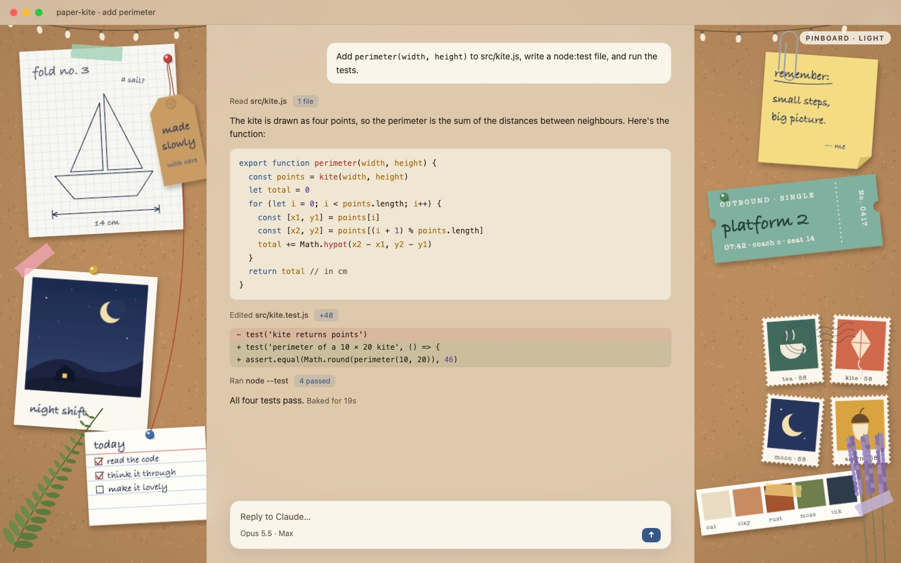
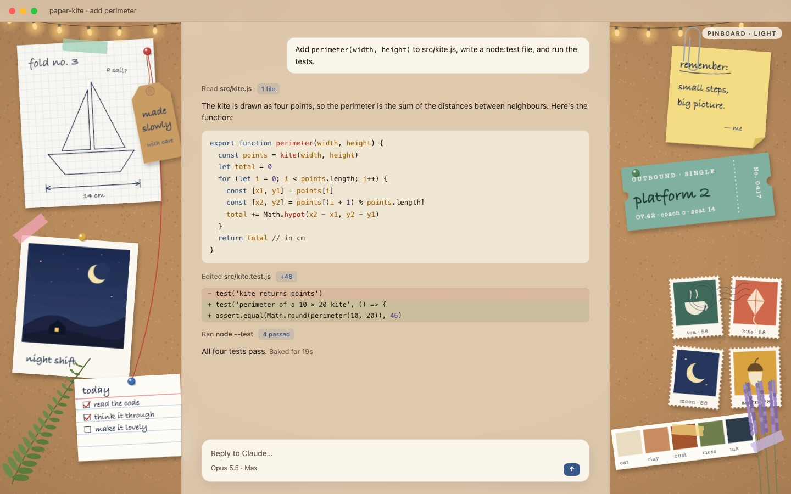

# Pinboard

A hand-made look for Claude's desktop and mobile apps. The conversation sits on frosted cream paper in the middle of a cork board, and the edges of the board hold pinned scraps: a paper-boat plan on graph paper, a polaroid of a cabin under the moon, a hanging kraft tag, an index card, a sticky note, a train ticket, postage stamps, paint swatches, a fern and some lavender.

- **Light mode**: warm cork and cream paper, ink-blue accents.
- **Dark mode**: the same board under a desk lamp, with a warm veil and string lights that softly twinkle.
- **While Claude works**: the string lights come on and run along the wire, and the tag sways a little faster. They settle when the turn ends.

| Light | Dark | While Claude works |
| --- | --- | --- |
|  |  |  |

## Install

At the prompt of a terminal session:

```
/plugin install pinboard --marketplace zjlgdx/claude-theme-pinboard
```

Answer `y` to add the marketplace, then choose a scope.

From a shell:

```
claude plugin install pinboard --marketplace zjlgdx/claude-theme-pinboard
```

In the desktop app, where `/plugin` does not run: click + next to the prompt box, then Plugins, Add marketplace with `zjlgdx/claude-theme-pinboard`, then Add plugin.

## Notes

- The backdrop is drawn in the desktop and mobile apps only; the terminal draws no look.
- Everything is one SVG animated with CSS alone: no script, nothing loaded.
- With "Reduce motion" on, the board stands still.
- The art keeps to two bands pinned to the left and right edges, so the words in the middle stay clear; on narrow windows the bands slide in and fade.
- A theme replaces any other mod's theme, so use one theme mod at a time.
